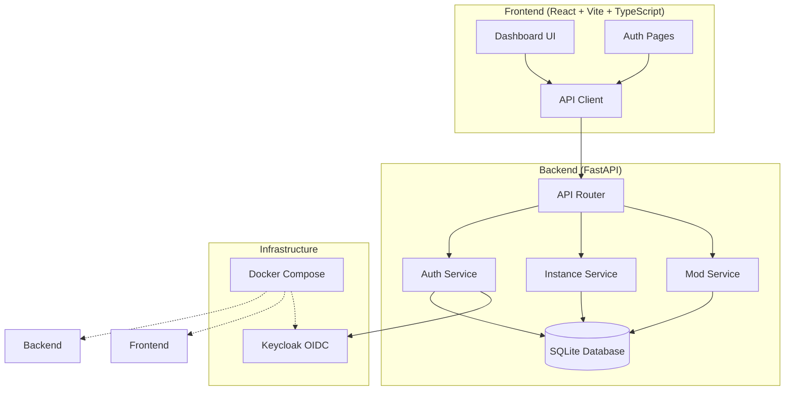

# Sentinel Pilot — Minecraft Launcher Management

> Work in progress. This checkpoint may be incomplete or fail tests. See PLAN.md and STATUS.md before use.


**Alan Vo | AI & Machine Learning** — alanvo@gmail.com

Sentinel Pilot is a Minecraft launcher management tool for organizing instances, mods, and configurations. Built with a modern FastAPI backend and React/TypeScript frontend.

## Features

- **Instance Management**: Create, configure, and launch Minecraft instances with different versions, loaders (Forge, Fabric, Quilt), and JVM settings
- **Mod Management**: Install and manage mods with version tracking, enable/disable toggles, and file hash verification
- **Authentication**: Secure OIDC login via Keycloak with session-based cookies and CSRF protection
- **Dark Mode**: Full dark/light theme support with persistence
- **Responsive UI**: Works on desktop and mobile browsers

## Architecture



## Quick Start

### Prerequisites

- Docker and Docker Compose
- Or: Python 3.12+, Node.js 24+

### Using Docker Compose (Recommended)

```bash
# Clone and navigate
git clone <repository-url>
cd sentinel-pilot-alan-vo

# Copy environment template
cp .env.example .env

# Start all services
docker-compose up -d

# Access the application
# Frontend: http://localhost:5173
# Backend API: http://localhost:8000
# Keycloak Admin: http://localhost:8080 (admin/admin)
```

### Local Development

```bash
# Backend
cd backend
python -m venv .venv
source .venv/bin/activate
pip install -r requirements.txt
cp ../.env.example .env
uvicorn app.main:app --reload --host 127.0.0.1 --port 8000

# Frontend (in another terminal)
cd frontend
npm install
npm run dev

# Keycloak (optional, for auth)
docker run -p 8080:8080 -e KEYCLOAK_ADMIN=admin -e KEYCLOAK_ADMIN_PASSWORD=admin quay.io/keycloak/keycloak:24.0 start-dev
```

## API Reference

### Health
- `GET /api/health` — Service health check
- `GET /api/health/db` — Database connectivity check

### Authentication
- `POST /api/auth/register` — Register new user
- `POST /api/auth/login` — Login (returns token + sets HttpOnly cookie)
- `POST /api/auth/logout` — Logout (clears cookie)
- `GET /api/auth/me` — Get current user
- `PATCH /api/auth/me` — Update current user

### Instances
- `GET /api/instances` — List instances (paginated, filterable)
- `POST /api/instances` — Create instance
- `GET /api/instances/{id}` — Get instance details
- `PATCH /api/instances/{id}` — Update instance
- `DELETE /api/instances/{id}` — Delete instance (operator+)

### Mods
- `GET /api/mods` — List mods (paginated, filterable)
- `POST /api/mods` — Create mod entry
- `POST /api/mods/upload` — Upload mod file
- `GET /api/mods/{id}` — Get mod details
- `PATCH /api/mods/{id}` — Update mod
- `DELETE /api/mods/{id}` — Delete mod (operator+)

## Configuration

### Environment Variables

| Variable | Description | Default |
|----------|-------------|---------|
| `ENVIRONMENT` | `development` or `production` | `development` |
| `DEBUG` | Enable debug mode | `true` |
| `SECRET_KEY` | JWT signing key (32+ chars) | Required in production |
| `DATABASE_URL` | SQLAlchemy database URL | `sqlite+aiosqlite:///./data/sentinel.db` |
| `KEYCLOAK_URL` | Keycloak server URL | `http://localhost:8080` |
| `KEYCLOAK_REALM` | Keycloak realm | `sentinel` |
| `KEYCLOAK_CLIENT_ID` | Keycloak client ID | `sentinel-pilot` |
| `KEYCLOAK_CLIENT_SECRET` | Keycloak client secret | Required for production |
| `CORS_ORIGINS` | Allowed CORS origins | `http://localhost:5173,http://127.0.0.1:5173` |
| `LLM_API_KEY` | LLM provider API key | Optional |
| `LLM_PROVIDER` | LLM provider (openai, anthropic, gemini, ollama) | Optional |
| `LLM_MODEL` | LLM model name | Optional |
| `LLM_BASE_URL` | Custom LLM base URL | Optional |
| `DEMO_MODE` | Enable demo mode (localhost only) | `false` |

### Keycloak Setup

1. Access Keycloak admin at http://localhost:8080 (admin/admin)
2. Create realm `sentinel`
3. Create client `sentinel-pilot` with:
   - Client authentication: ON
   - Standard flow: ON
   - Direct access grants: ON
   - Valid redirect URIs: `http://localhost:5173/*`
   - Web origins: `http://localhost:5173`
4. Copy client secret to `KEYCLOAK_CLIENT_SECRET`
5. Create roles: `viewer`, `operator`, `admin`
6. Create users and assign roles

### SAML Identity Provider Brokering

Keycloak supports upstream SAML IdPs through identity brokering:

1. In Keycloak admin, go to Identity Providers → Add SAML v2.0
2. Configure SAML entity ID, SSO URL, and certificates from your IdP
3. Set up mappers for email, name, roles
4. Users can then log in via your corporate SAML IdP

## Security

- **Authentication**: OIDC authorization code flow with PKCE via Keycloak
- **Sessions**: HttpOnly, SameSite=Lax cookies with CSRF protection
- **Tokens**: JWT with HS256, 30-minute expiry
- **Roles**: `viewer` (read), `operator` (write), `admin` (all)
- **Demo Mode**: Localhost-bound only, refuses to start in production
- **Secrets**: No credentials in code; all via environment variables

### Limitations

- SQLite for development; use PostgreSQL for production
- No rate limiting implemented
- LLM integration is advisory only (opt-in, labeled)
- Demo mode not for production use

## Testing

```bash
# Backend tests
cd backend
.venv/bin/python -m pytest tests/ -v

# Frontend tests
cd frontend
npm test

# Type checking
npm run build  # Includes tsc
```

## Deployment

### TLS Reverse Proxy (Required for Production)

```nginx
# nginx.conf example
server {
    listen 443 ssl http2;
    server_name your-domain.com;

    ssl_certificate /path/to/cert.pem;
    ssl_certificate_key /path/to/key.pem;

    location / {
        proxy_pass http://localhost:5173;
        proxy_set_header Host $host;
        proxy_set_header X-Real-IP $remote_addr;
        proxy_set_header X-Forwarded-For $proxy_add_x_forwarded_for;
        proxy_set_header X-Forwarded-Proto $scheme;
    }

    location /api/ {
        proxy_pass http://localhost:8000;
        proxy_set_header Host $host;
        proxy_set_header X-Real-IP $remote_addr;
        proxy_set_header X-Forwarded-For $proxy_add_x_forwarded_for;
        proxy_set_header X-Forwarded-Proto $scheme;
    }
}
```

### Backup & Restore

```bash
# Backup database
docker-compose exec backend cp /app/data/sentinel.db /app/data/sentinel.db.backup

# Restore database
docker-compose exec backend cp /app/data/sentinel.db.backup /app/data/sentinel.db
```

## Development

### Project Structure

```
sentinel-pilot-alan-vo/
├── backend/
│   ├── app/
│   │   ├── api/          # API routes
│   │   ├── core/         # Config, database, security
│   │   ├── models/       # SQLAlchemy models
│   │   └── main.py       # FastAPI app factory
│   ├── tests/            # Pytest tests
│   └── requirements.txt
├── frontend/
│   ├── src/
│   │   ├── components/   # React components
│   │   ├── pages/        # Page components
│   │   ├── hooks/        # Zustand stores
│   │   ├── api/          # API client
│   │   ├── types/        # TypeScript types
│   │   └── styles/       # CSS
│   ├── package.json
│   └── vite.config.ts
├── docker-compose.yaml
├── Dockerfile.backend
├── Dockerfile.frontend
└── .github/workflows/ci.yml
```

### Adding Features

1. Define API models in `backend/app/models/`
2. Create API routes in `backend/app/api/`
3. Add frontend types in `frontend/src/types/api.ts`
4. Create Zustand store in `frontend/src/hooks/`
5. Build UI components in `frontend/src/components/`
6. Create pages in `frontend/src/pages/`
7. Write tests for both backend and frontend

## License

MIT License — Copyright (c) 2026 Alan Vo <alanvo@gmail.com>

## Changelog

### 1.0.0 (2026-10-22)
- Initial release
- FastAPI backend with instance/mod management
- React/TypeScript frontend with authentication
- Docker Compose with Keycloak OIDC
- CI/CD pipeline with tests and Docker builds